# Inventory Manager — DevOps Capstone

[](https://github.com/MohitSAGAR11/devops_finalAssignment/actions/workflows/ci-cd.yml)

A warehouse stock-control app (React + FastAPI + PostgreSQL) delivered through a complete DevOps pipeline: tested and security-scanned in GitHub Actions, packaged as containers, deployed with Helm to an AWS EKS cluster provisioned by Terraform, and monitored with Prometheus and Grafana.

## 🎬 Demo

https://github.com/user-attachments/assets/e9c0a7c2-6075-46f0-8683-6d221fcdde3b

**[▶ Watch the demo video](demo/demo.mp4)**: a code change is committed and pushed, the pipeline tests, scans and deploys it, and the new version appears live on EKS.

**[📊 Presentation slides](demo/Inventory_Manager_DevOps_Capstone.pptx)**: 12-slide walkthrough of the project, with speaker notes.

---


## Architecture

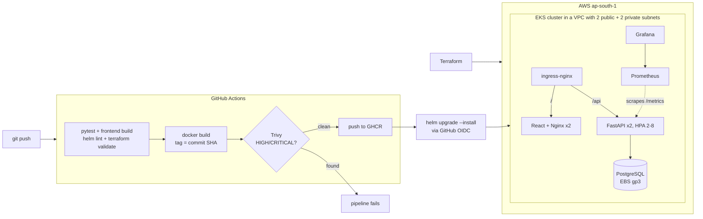

| Layer | Technology |
|---|---|
| Frontend | React 18 + Vite, served by unprivileged Nginx |
| Backend | FastAPI, SQLAlchemy 2, Alembic migrations |
| Database | PostgreSQL 16 |
| Testing | Pytest (19 tests, isolated SQLite DB) |
| Containers | Docker multi-stage builds, non-root users, Docker Compose |
| CI/CD | GitHub Actions → GitHub Container Registry, SHA-tagged images |
| Security | Trivy image scanning, SHA-pinned actions, keyless AWS access via OIDC |
| Infrastructure | Terraform: VPC, NAT, EKS, managed node group, EBS CSI driver |
| Orchestration | Kubernetes, Helm, ingress-nginx, HorizontalPodAutoscaler |
| Observability | Prometheus, Grafana, `prometheus-fastapi-instrumentator` |

---

## 1. Application

Track products by SKU, receive or ship stock with one click, get reorder alerts when stock falls to the reorder level, and see total inventory value.

| UI (`localhost:3000`) | API docs (`/docs`) |
|---|---|
| 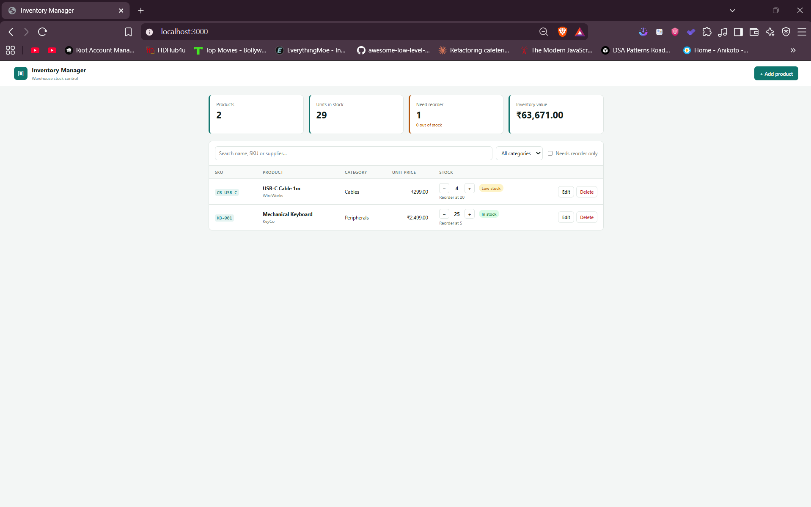 | 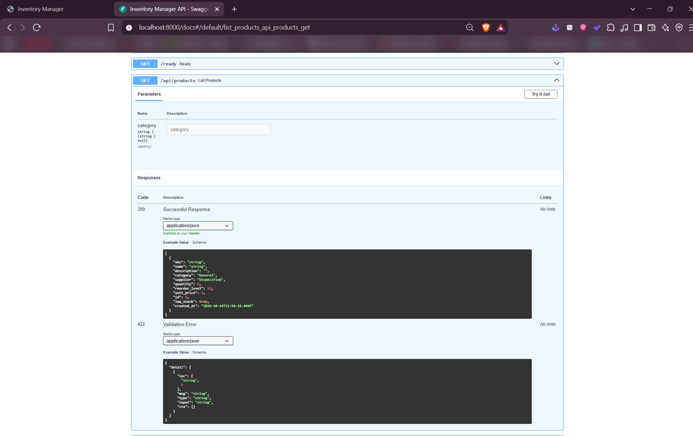 |

| Method | Endpoint | Purpose |
|---|---|---|
| GET | `/health` · `/ready` · `/metrics` | Liveness, readiness (DB check), Prometheus metrics |
| GET | `/api/products` · `/api/products/{id}` | List (optional `?category=`) / get one |
| POST | `/api/products` | Create (409 on duplicate SKU) |
| PUT | `/api/products/{id}` | Update |
| POST | `/api/products/{id}/adjust` | Receive (`+n`) or ship (`-n`) stock, never below zero |
| DELETE | `/api/products/{id}` | Delete |
| GET | `/api/products/stats` | Totals, low stock, out of stock, inventory value |

The schema is managed by **Alembic** (`0001_create_products` → `0002_add_sku_price_reorder`):

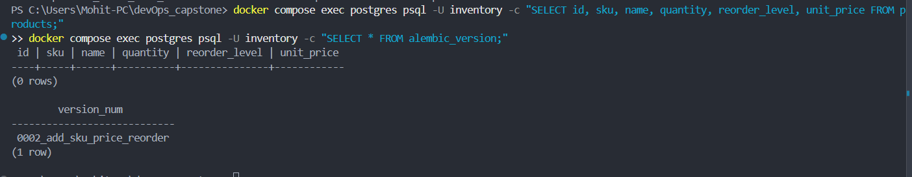

## 2. Run locally

```bash
docker compose up --build        # UI :3000 · API :8000/docs · Postgres :5433
```

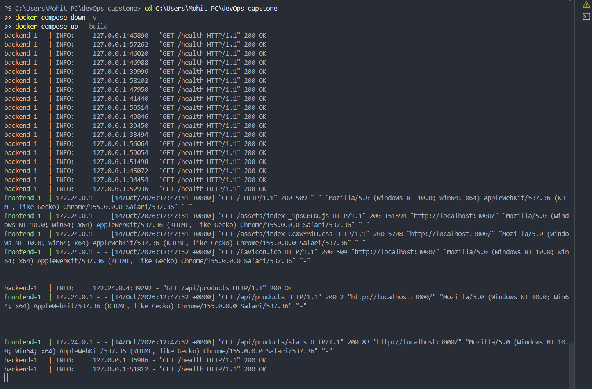

## 3. Tests

```bash
cd backend && pip install -r requirements.txt && pytest -v
```

19 tests cover every endpoint, validation, duplicate SKUs, stock rules and stats. They run against a throwaway SQLite database, never the real Postgres.

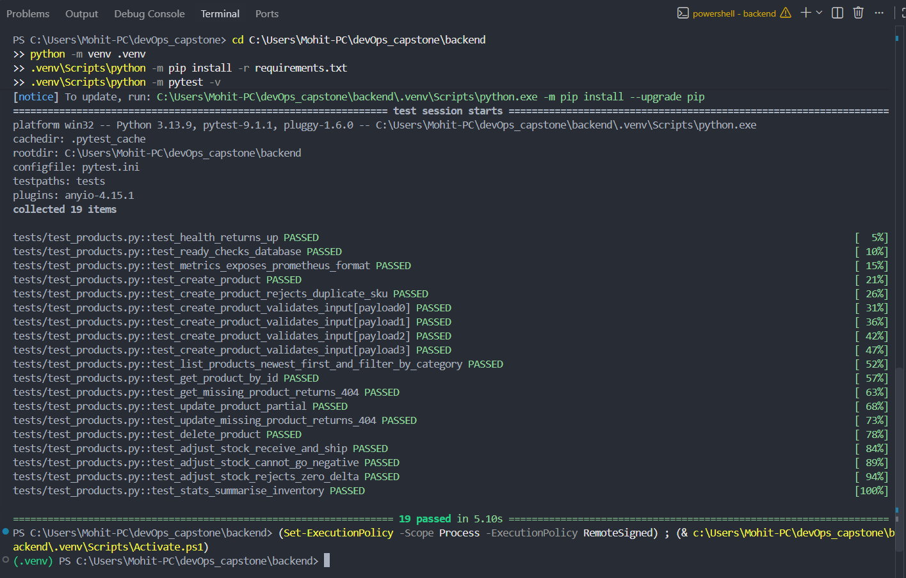

## 4. Git

Every change is a focused commit with a descriptive message.

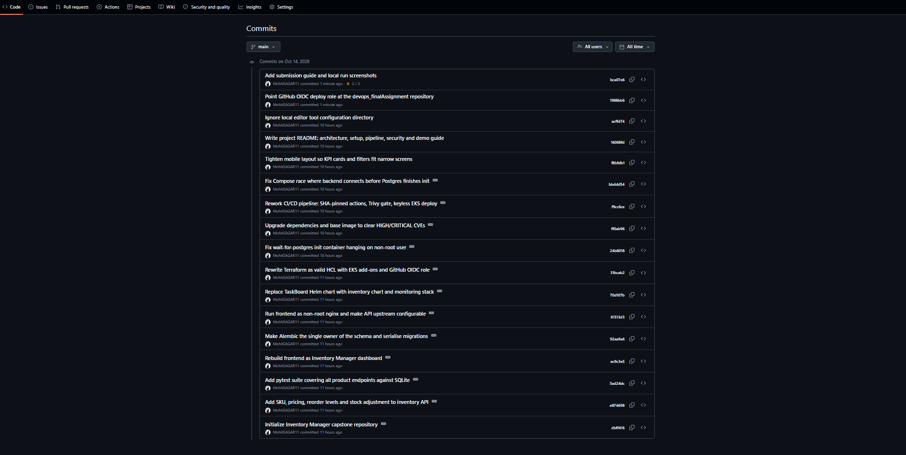

## 5. CI/CD pipeline

[`.github/workflows/ci-cd.yml`](.github/workflows/ci-cd.yml) runs on every push to `main`:

1. **test**: `pytest`, frontend build
2. **lint-infra**: `helm lint`, `terraform fmt` + `validate`
3. **build-scan-push**: build both images, tag them with the **commit SHA**, Trivy scan, push to GHCR
4. **deploy**: assume an AWS role via GitHub OIDC (no stored keys), then `helm upgrade --install` on EKS

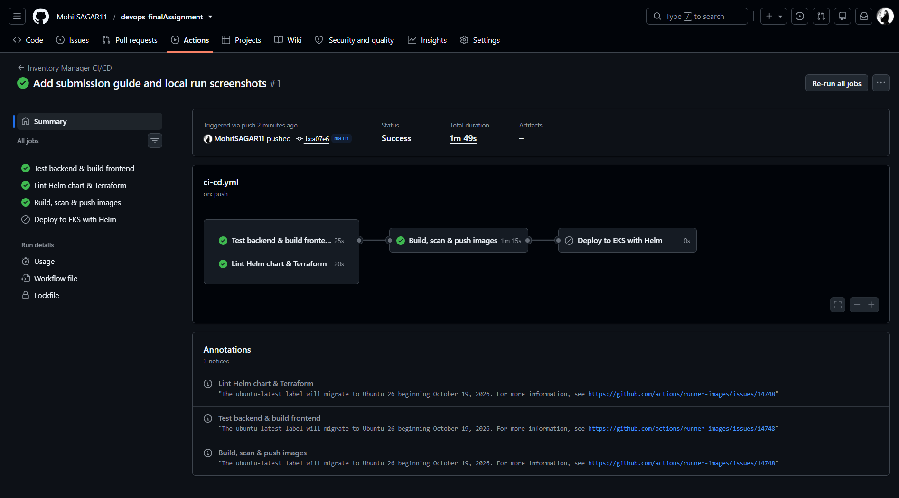

Images in GHCR are tagged with the commit SHA, so every running pod traces back to an exact commit:

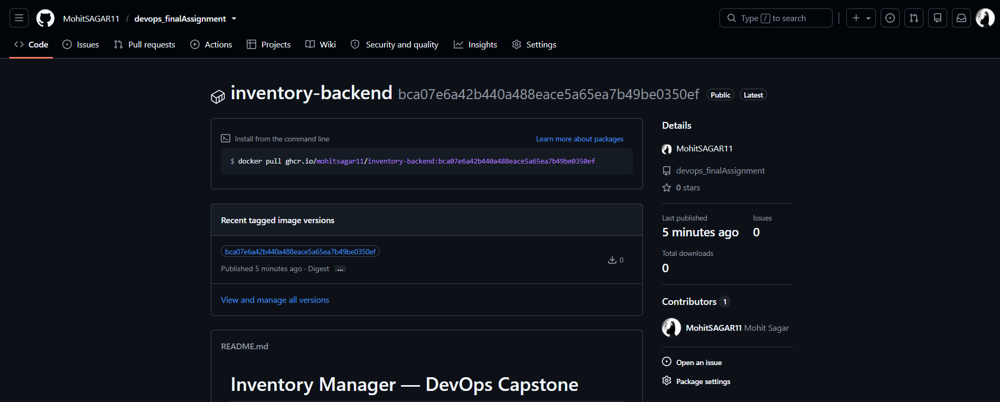

## 6. Security: Trivy

Both images are scanned before they are pushed. The job fails on any **HIGH/CRITICAL** CVE that has a fix available, so a vulnerable image never reaches the registry.

The first scan of this project failed. The backend shipped `starlette 0.41.3` with **CVE-2025-62727**, where a crafted HTTP `Range` header makes the server burn CPU and deny service to other users. The nginx 1.27 base image also had fixable CVEs in libxml2, musl and zlib. Upgrading FastAPI/Starlette and moving to `nginx-unprivileged:1.30` with `apk upgrade` brought both images to **0 HIGH/CRITICAL**.

Every GitHub Action is pinned to a commit SHA, because in March 2026 most `trivy-action` tags were rewritten with malicious code (CVE-2026-33634).

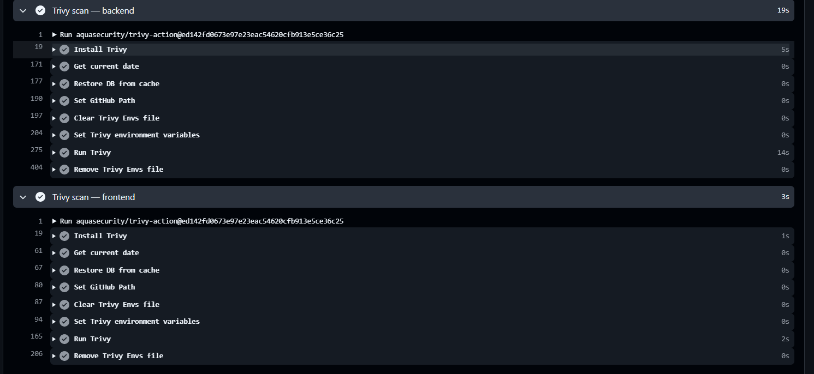

## 7. Infrastructure: Terraform on AWS

[`terraform/`](terraform/) provisions a VPC (2 public + 2 private subnets, NAT gateway), an EKS 1.34 cluster with a 2-node `m7i-flex.large` group, the EBS CSI driver, and the GitHub OIDC deploy role.

| `terraform plan`: 66 resources | VPC subnets |
|---|---|
| 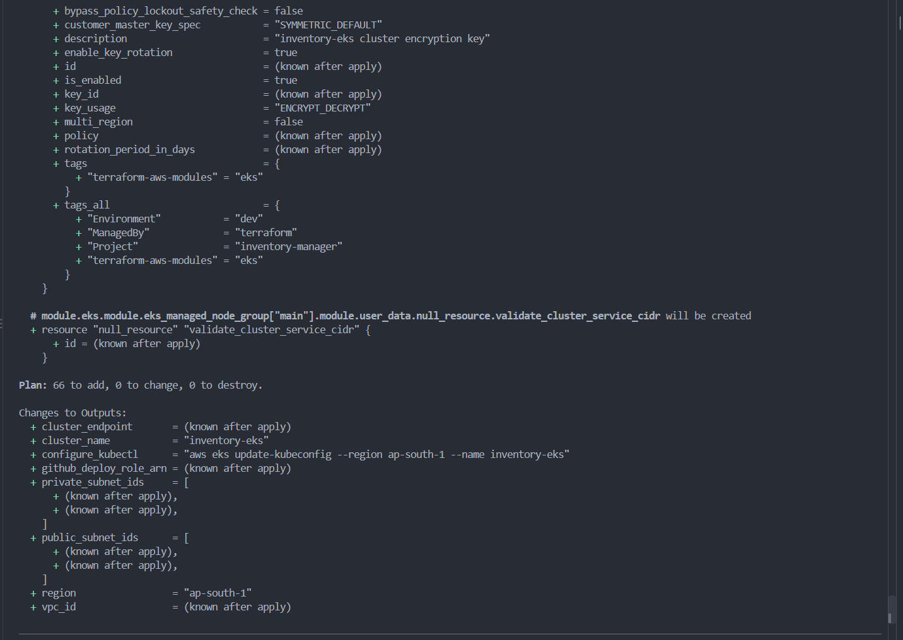 | 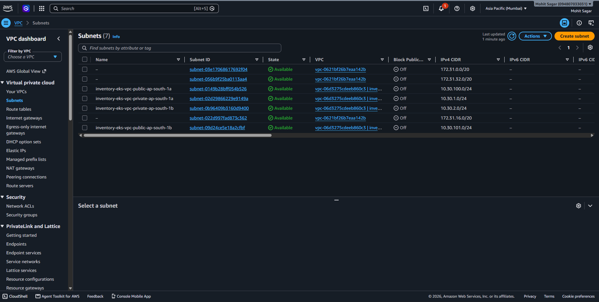 |

| EKS node group (Active) | `terraform destroy`: 66 destroyed |
|---|---|
| 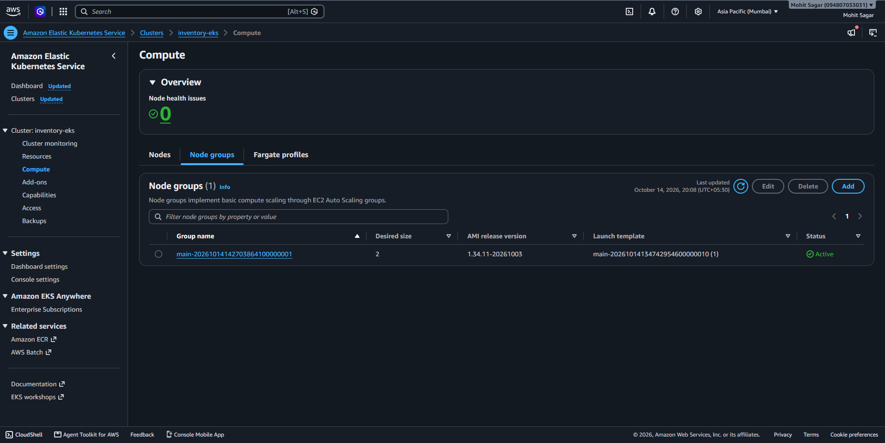 | 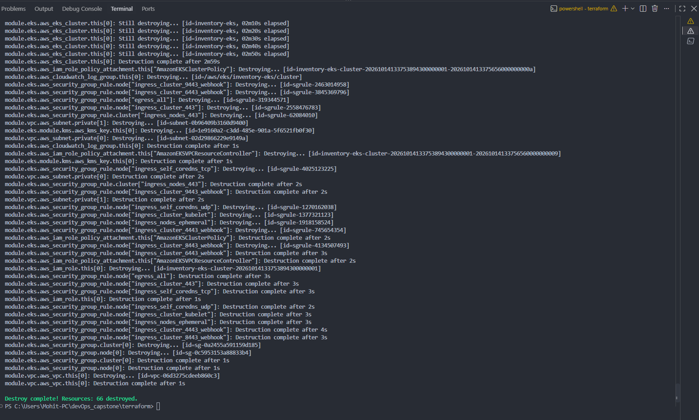 |

## 8. Kubernetes + Helm

The [`helm/inventory`](helm/inventory/) chart deploys:
- backend and frontend Deployments (2 replicas each, non-root, health probes)
- a Postgres StatefulSet on an EBS volume
- ClusterIP Services
- an Ingress (`/` → frontend, `/api` → backend)
- a backend HPA
- a ServiceMonitor and a Grafana dashboard

| Pods (all Running) | Services (ClusterIP) |
|---|---|
| 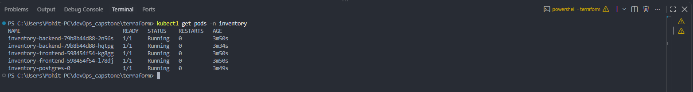 | 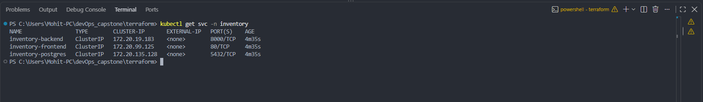 |

Ingress on the AWS load balancer, and Deployments running the SHA-tagged images released by `helm upgrade --install` ([deploy log](https://github.com/MohitSAGAR11/devops_finalAssignment/actions/runs/38590587449): `STATUS: deployed, REVISION: 2`):

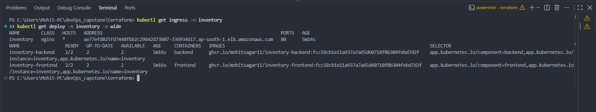

The app served through the Ingress, and the HPA tracking CPU (2–8 replicas, 60% target):

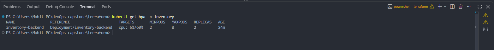

## 9. Observability

| `/metrics` from the backend pod | Prometheus target: 2/2 UP |
|---|---|
| 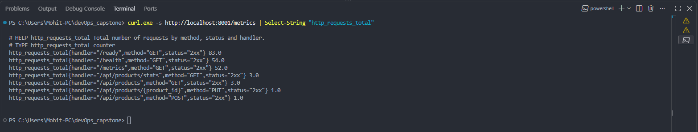 | 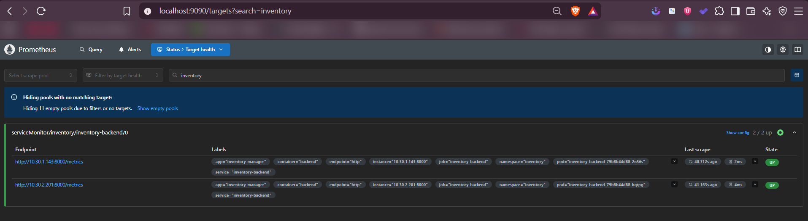 |

Grafana dashboard under load: request rate, p95 latency, status classes and per-pod CPU. *5xx error rate* shows "No data" because there were no server errors.

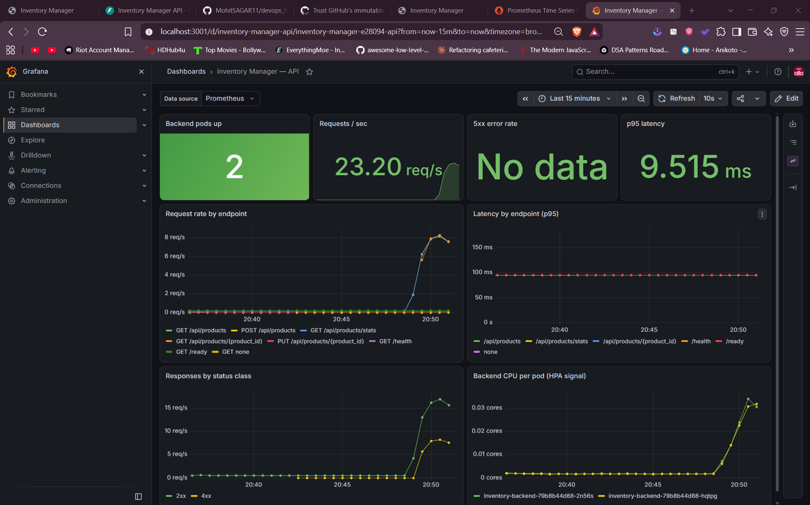

---

## Problems solved along the way

| Problem | Fix |
|---|---|
| Trivy blocked the first release (CVE-2025-62727 and others) | Upgraded Starlette/FastAPI and the nginx base image |
| Two backend replicas raced on DB migrations | Postgres advisory lock in `alembic/env.py` |
| Backend connected before Postgres finished first-boot init | TCP health check (`pg_isready -h localhost`) |
| Init container hung: `pg_isready` gives "no attempt" as a non-root user | Pass `-U` explicitly |
| AWS Free plan rejected `t3.medium` nodes | Switched to free-plan-eligible `m7i-flex.large` |
| CI deploy denied `AssumeRoleWithWebIdentity` | Trusted GitHub's immutable OIDC subject (`repo:owner@id/name@id`) |
| Uppercase GitHub username is invalid in GHCR image names | Lowercased the owner in the workflow |

## Deploy it yourself

```bash
cd terraform && cp terraform.tfvars.example terraform.tfvars && terraform init && terraform apply
aws eks update-kubeconfig --region ap-south-1 --name inventory-eks
./scripts/bootstrap-cluster.sh        # ingress-nginx, metrics-server, Prometheus + Grafana
# GitHub: secrets AWS_DEPLOY_ROLE_ARN + POSTGRES_PASSWORD, variable EKS_CLUSTER_NAME → push to main
URL=http://<load-balancer> ./scripts/load-test.sh
```

Tear down: `helm uninstall` the releases, `kubectl delete pvc --all -n inventory`, then `terraform destroy`.

## Repository layout

```text
backend/        FastAPI app, Alembic migrations, pytest suite, Dockerfile
frontend/       React app, Nginx config template, multi-stage Dockerfile
helm/inventory/ Helm chart (values, values-dev, values-prod)
terraform/      VPC, EKS, EBS CSI, GitHub OIDC role
k8s/            Namespaces, gp3 StorageClass
monitoring/     Prometheus and Grafana values for kube-prometheus-stack
scripts/        Cluster bootstrap, load test
troubleshooting/ Broken image / broken Service labs
.github/        CI/CD workflow
```
